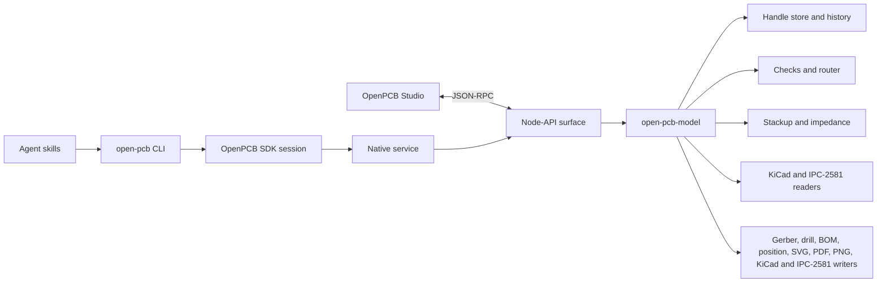

# Architecture

OpenPCB has one board model and several ways to reach it. The command line, the
SDK, the studio and the agent skill all describe the same revision of the same
document; none of them keeps a second copy.

## Board document

An `.opcb` file is UTF-8 JSON with a fixed envelope:

```json
{ "format": "open-pcb-board", "version": 1, "document": { "...": "..." } }
```

The document holds:

- **Layers**: id, title, index, kind (`copper`, `silkscreen`, `soldermask`,
  `assembly`, `mechanical`), color, visibility and lock state.
- **Outline**: one rectangle given by its lower-left and upper-right corners.
- **Nets** and **footprints**: reference, value, footprint name, placement,
  rotation, layer and pads (number, position, width, height, net).
- **Copper objects**: tracks (net, layer, endpoints, width, teardrop marker),
  vias (net, position, diameter, drill, layer span, back-drill depth and stub),
  plated routed slots, copper pours, copper keepouts and silkscreen text items.
- **Design intent**: differential pairs, net classes, test points, design rules,
  the physical stackup, waivers and severity overrides.

Object ids are stable (`track-1`, `via-1`, `keepout-1`, …). Reports and edits
refer to those ids, so a rename or a reroute does not invalidate a reference.

## Module boundaries

| Layer | Location | Responsibility |
|-------|----------|----------------|
| Model | `projects/crates/pcb-model` | The only implementation: board struct, validation, edits, checks, router, stackup and impedance, importers, exporters and the capability matrix. |
| Native bridge | `projects/crates/pcb-napi` | One Node-API export per operation, each returning a JSON string. Maps values, prefixes error codes and hosts the WebView. |
| SDK and CLI | `projects/packages/open-pcb` | Typed arguments, stable error codes, format registry, history modes, help text and exit codes. No board semantics. |
| Studio | `projects/packages/open-pcb-ui` | Desktop and web window, talking to the same native operations over JSON-RPC. |
| Skill | `projects/packages/open-pcb-skills` | Markdown instructions that mirror the CLI and the capability matrix. |
| Platform addons | `projects/packages/open-pcb-<platform>-<arch>` | Prebuilt `.node` artifacts. Not import targets. |

The rule is enforced by construction: the TypeScript layer cannot add a layer,
compute an impedance or write a Gerber file. It parses arguments, calls one
native operation and renders the result.

## Data flow



A session call crosses the same path every time: argument validation in the SDK,
one native call, one JSON result decoded into a typed value. The CLI adds no
logic of its own, which is why a CLI result and an SDK result for the same
operation are the same shape.

## Determinism and revisions

- **Deterministic routing.** The router tries four L-shaped candidates per edge
  and reports an edge as unrouted when none is free. Via stitching walks the
  inset outline at an even spacing and skips occupied positions.
- **Fixed output sets.** Gerber export always writes the same file names;
  reports emit issues in check order and objects in document order.
- **One revision per accepted mutation.** A rejected edit leaves the document,
  its revision and its file untouched. The CLI saves through a temporary file
  and a rename, so a reader never sees a partial document.
- **Import is a new document.** A KiCad or IPC-2581 import produces a new
  revision plus a loss ledger in source order; the source file is not edited.

## Error semantics

The model returns `ServiceError { code, message }`. The native bridge prefixes
the code into its error text (`code: message`), and the SDK wraps it in an
`OpenPCBError` that keeps `code`, `recoverable` and `details` as contract.

Stable codes:

```text
session/disposed            session/argument-invalid     session/budget-exceeded
board/not-found             board/revision-conflict      board/history-empty
board/layer-locked          object/not-found             object/unsupported
format/unsupported          format/unsupported-version   format/invalid
capability/not-implemented
```

Callers compare codes, never messages. An unsupported export fails with
`capability/not-implemented` before a file is written. A missing native addon
produces the same code through `NotImplementedError`, so an installation problem
is never reported as an empty board.

CLI exit codes: `0` success, `1` an inspection that did not pass or a GUI
failure, `2` a usage or argument failure.

## Undo history ownership

History belongs to the layer that owns the file:

- **Memory mode (SDK default and studio).** The native handle store keeps up to
  32 snapshots per handle and clears the redo branch on every accepted edit.
  `canUndo` and `canRedo` appear on every summary and edit result.
- **Sidecar mode (CLI, opt-in SDK).** The session records the previous document
  in `<file>.history.json` beside the target, up to 32 snapshots, so `undo` and
  `redo` work across process boundaries. The sidecar module is loaded with a
  dynamic import, so a memory session never loads `node:fs`.

Undo intentionally stays outside `.opcb`: a document remains portable on its
own, and a sidecar can be deleted without touching board data.

## Studio

`projects/packages/open-pcb-ui` is a VMZ static page. `vmz build . --profile
static` emits `dist/static`, which staging copies to
`projects/packages/open-pcb/dist/gui` for the native WebView host. The page talks
to the host over `chrome.webview.postMessage` JSON-RPC (`ready`, `capabilities`,
`board.create`, `board.open`, `board.save`, `board.close`, `close`). Without a
WebView host it shows an empty canvas and a "preview mode" status; it never
fabricates a board. Studio build commands live in
[development.md](development.md).

## Workspace layout

```text
Cargo.toml                                  Rust workspace: projects/crates/*
projects/crates/pcb-model                   board model and all semantics
projects/crates/pcb-napi                    Node-API surface and WebView host
projects/packages/open-pcb                  SDK, CLI and native discovery
projects/packages/open-pcb-ui               OpenPCB Studio (VMZ)
projects/packages/open-pcb-skills           agent skill package
projects/packages/open-pcb-<platform>-<arch> five native addon packages
projects/sites/homepage                     product site
wae.config.ts                               native build, staging and skill config
.github/workflows/                          Rust, TypeScript and publish workflows
```

The Rust workspace defaults to `pcb-napi`; the pnpm workspace covers
`projects/packages/*` and `projects/sites/*`. See
[development.md](development.md) for the commands that build and stage them.
