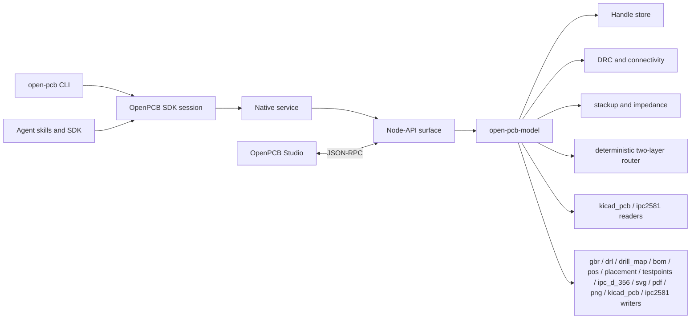

# OpenPCB

[](https://github.com/nyar-os/OpenPCB)
[](https://github.com/nyar-os/OpenPCB)
[](https://github.com/nyar-os/OpenPCB)

One editable board document behind PCB layout, inspection, fabrication and
assembly.

OpenPCB is a desktop studio and command line for embedded printed circuit
boards. A project is a single `.opcb` document: copper layers and stackup,
footprints, nets, tracks and vias, plus fabrication and assembly state stay in
one revisioned model instead of being scattered across a folder of exchange
files.

## Status

This repository ships a tested MVP of the board document. The command line,
SDK and studio shell share one native model:

- Create, open, save, inspect, export and close a revisioned `.opcb` document.
- Add nets, footprints, tracks, through, blind or buried vias and plated routed
  slots; record a back-drill depth and remaining stub on a through via; move and
  update footprints; delete footprints, tracks, vias and slots.
- Add, rename, hide and lock layers; set a rectangular board outline; read and
  edit the design rules the checks and writers use, including the solder-mask
  expansion.
- Declare a physical stackup (copper foil thickness, dielectric height and
  permittivity), compute microstrip, stripline, edge-coupled differential
  microstrip or edge-coupled differential stripline impedance from it, and
  convert a target impedance (single-ended or differential) to the trace width
  that reaches it; per-request overrides replace the stored values without
  changing the document.
- Declare copper pour regions on copper layers as closed polygons; the Gerber
  writer emits each one as a `G36`/`G37` region and the SVG and PDF previews
  draw the pour.
- Declare copper keepout regions on one copper layer or on `*` for the whole
  stack; update their layer or polygon in place, report each one's area and
  perimeter, and let the `keepout` check flag any track, via, pad or pour that
  enters one.
- Generate a stitching via fence on a declared net around the inset board
  outline; the ring is evenly spaced, deterministic, and skips positions that
  already hold a via.
- Undo and redo up to 32 snapshots per handle, optionally persisted in
  `<file>.history.json` with `history: 'sidecar'`, with `canUndo`/`canRedo` on
  every summary and edit result.
- Route every net with at least two pads through a deterministic two-layer
  autorouter that reports collisions instead of inventing copper; track segments
  and vias treat every applicable copper keepout as a hard obstacle.
- Declare differential pairs with a target width, gap and maximum length skew,
  then compare the routed copper against those targets.
- Generate linear teardrops at every pad-track junction as ordinary copper
  tracks; repeated runs skip segments that already exist.
- Run DRC, connectivity, clearance, annular ring, stackup, outline, silkscreen,
  courtyard, netlist, `annular-ring`, `track-width`, `unrouted`, `diffpair`,
  `dangling-copper`, `hole-to-hole`, `copper-to-edge`, `edge-clearance`,
  `silkscreen-over-pad`, `netclass`, `keepout` and `via-in-pad` checks. Waive a
  finding by code (optionally narrowed to one object) and override a code's
  severity; a waived error no longer blocks `passed`, and every waived issue is
  still reported with its waiver.
- Report copper area per copper layer from tracks, vias, pads and pours, the
  rectangular board area, each layer's coverage and the coverage imbalance
  across layers.
- Declare net classes with optional target width, clearance, via diameter and via
  drill; assign nets to a class and let `clearance` use the strictest class value
  and `netclass` enforce the width and via targets.
- Mark existing pads and vias as test points and export a CSV probe report with
  the pad key or via id, designator, net, layer and millimetre coordinates.
- Export an IPC-D-356A bare-board test netlist: every pad is a fixed-width `327`
  record, every via a `317` or `307` record, with net, reference, pin, hole,
  access side, millimetre coordinates and pad size in the standard columns.
- Import a KiCad PCB or IPC-2581 document into the native document: copper
  layers, nets, footprints and pads, tracks, through, blind and buried vias and a
  rectangular profile, with a stable loss ledger for everything the document
  cannot hold. Micro vias imported from KiCad stay in that ledger instead of
  being approximated.
- Write Gerber RS-274X, Excellon drill, drill map SVG, BOM, pick-and-place,
  placement JSON, test point CSV, IPC-D-356 netlist, SVG, vector PDF, 8-bit RGB
  PNG, KiCad PCB and IPC-2581 files atomically. Gerber writes one file per copper
  layer plus `F_SilkS`, `B_SilkS`, `F_Mask`, `B_Mask`, `F_Paste`, `B_Paste` and
  `Edge_Cuts`; every file carries Gerber X2 file and
  aperture attributes (`%TF.FileFunction`, `%TF.Part`, `%TF.FilePolarity` and
  `%TA.AperFunction`); the two silkscreen files carry the legend
  tracks the document holds, the mask files open every outer-layer pad by the
  document's solder-mask expansion while vias stay tented, and the paste files
  open a stencil window exactly the size of each outer-layer pad.
  Copper pour regions
  are written as `G36`/`G37` regions in the Gerber file of their layer. One
  Excellon file lists every drilled hole, including blind and buried
  vias, and writes every plated slot as a `G85` routed segment under a tool
  whose diameter is the slot width; back-drilled vias repeat their hit under a
  `;Back drill` comment carrying the depth and stub. The drill map draws every
  plated hole and slot with a tool legend and marks back-drilled hits. IPC-2581
  holes carry `backDrillDepth` and `backDrillStub`, so a written and re-read
  document keeps the back drill.

STEP export remains declared and rejects with `capability/not-implemented`. PNG
is an export writer only; preview rendering stays SVG-only. The interactive
viewport renderer is not implemented either. The capability matrix reports
through, blind and buried vias, back drilling, linear teardrops, editable design
rules, solder-mask and solder-paste Gerber layers, Gerber X2 attributes, copper
pour regions, copper keepouts, via stitching, plated routed slots, the
`via-in-pad` check, the copper area and balance report, net classes, test point
reports, stackup definition, single-ended and differential trace impedance,
controlled-width conversion and waiver/severity policy as supported, micro vias as unsupported,
and both `kicad_pcb` and `ipc2581` import as supported. `open-pcb capabilities`
prints exactly that matrix.

## Usage

```bash
# Print the implemented capability matrix
open-pcb capabilities

# Create a native board document
open-pcb create --out blinker.opcb --title "Blinker" --template blank

# Import a KiCad board or an IPC-2581 document and report every construct the
# document could not keep; the format is detected from the content
open-pcb import legacy.kicad_pcb --out legacy.opcb
open-pcb import panel.ipc2581 --out panel.opcb

# Generate linear teardrops at pad-track junctions
open-pcb teardrop blinker.opcb --shape linear --length 0.6

# Declare a differential pair with its routing targets
open-pcb diffpair add blinker.opcb --positive USB_D+ --negative USB_D- --width 0.2 --gap 0.15 --max-skew 0.5
open-pcb diffpair delete blinker.opcb --id dp-1

# Declare a net, place a footprint, route a track and add a via
open-pcb net add blinker.opcb --name VCC
open-pcb footprint add blinker.opcb --ref U1 --value MCU --footprint QFN32 --x 30 --y 20 --rotation 0 --layer F.Cu
open-pcb track add blinker.opcb --net VCC --layer F.Cu --from 10,10 --to 30,10 --width 0.25
open-pcb via add blinker.opcb --net VCC --at 20,20 --diameter 0.6 --drill 0.3
open-pcb via add blinker.opcb --net VCC --at 25,20 --diameter 0.6 --drill 0.3 --from-layer F.Cu --to-layer In1
open-pcb via backdrill blinker.opcb --id via-1 --depth 0.8 --stub 0.2

# Add a plated routed slot and delete it by id
open-pcb slot add blinker.opcb --net VCC --from 20,15 --to 30,15 --width 0.8
open-pcb slot delete blinker.opcb --id slot-1

# Generate a stitching via fence around the inset board outline
open-pcb stitch blinker.opcb --net VCC --spacing 8 --inset 1 --diameter 0.6 --drill 0.3

# Route all two-pad nets, then route only VCC at a wider width
open-pcb route blinker.opcb
open-pcb route blinker.opcb --width 0.3 --clearance 0.2 --via 0.6 --net VCC

# Move, update or delete a footprint; delete a track or via by id
open-pcb footprint move blinker.opcb --id fp-1 --x 40 --y 25 --rotation 90
open-pcb footprint update blinker.opcb --id fp-1 --value SAMD21 --footprint TQFP32
open-pcb footprint delete blinker.opcb --id fp-1
open-pcb track delete blinker.opcb --id track-1
open-pcb via delete blinker.opcb --id via-1

# Add, rename, hide and lock a layer
open-pcb layer add blinker.opcb --name Inner1 --kind copper
open-pcb layer rename blinker.opcb --id Inner1 --name Inner2
open-pcb layer visible blinker.opcb --id Inner2 --visible false
open-pcb layer lock blinker.opcb --id Inner2 --locked true

# Add a copper pour region and delete it by id
open-pcb zone add blinker.opcb --layer F.Cu --net VCC --points "5,5 40,5 40,30 5,30"
open-pcb zone delete blinker.opcb --id zone-1

# Add a copper keepout region, resize and re-layer it, then report its area
open-pcb keepout add blinker.opcb --layer F.Cu --points "45,5 60,5 60,20 45,20"
open-pcb keepout update blinker.opcb --id keepout-1 --layer "*" --points "45,5 60,5 60,20 45,20"
open-pcb keepout list blinker.opcb
open-pcb keepout delete blinker.opcb --id keepout-1

# Declare a net class and move nets into it
open-pcb netclass add blinker.opcb --name Power --width 0.5 --clearance 0.6 --via-diameter 0.8 --via-drill 0.4
open-pcb netclass assign blinker.opcb --net VCC --class Power

# Mark a pad and a via as test points, then write the probe report
open-pcb testpoint add blinker.opcb --target fp-1:1
open-pcb testpoint add blinker.opcb --target via-1

# Set a rectangular outline, then undo or redo the last saved revision
open-pcb outline set blinker.opcb --from 0,0 --to 100,80
open-pcb rules show blinker.opcb
open-pcb rules set blinker.opcb --hole-clearance 0.3 --solder-mask-expansion 0.1
open-pcb severity set blinker.opcb --code drc/track-width-too-small --severity info
open-pcb waiver add blinker.opcb --code drc/footprint-no-pads --object fp-1 --reason mechanical
open-pcb waiver delete blinker.opcb --id waiver-1
open-pcb stackup set blinker.opcb --copper-thickness 0.035 --dielectric-height 0.2 --dielectric-constant 4.2
open-pcb stackup impedance blinker.opcb --structure microstrip --width 0.2
open-pcb stackup impedance blinker.opcb --structure diffMicrostrip --width 0.15 --gap 0.2
open-pcb stackup width blinker.opcb --structure stripline --impedance 50
open-pcb stackup width blinker.opcb --structure diffStripline --impedance 90 --gap 0.2
open-pcb undo blinker.opcb
open-pcb redo blinker.opcb

# Read the board and run the implemented checks
open-pcb list blinker.opcb
open-pcb inspect blinker.opcb --checks drc,connectivity,clearance,annular-ring,track-width,unrouted,stackup,outline,edge-clearance,via-in-pad

# Report copper area per layer and the coverage imbalance
open-pcb copper balance blinker.opcb

# Export the implemented targets; Gerber writes copper, silk, mask, paste and edge cuts
open-pcb export blinker.opcb --format gbr --out gerber
open-pcb export blinker.opcb --format drl --out blinker.drl
open-pcb export blinker.opcb --format drill_map --out blinker.drill-map.svg
open-pcb export blinker.opcb --format bom --out blinker.bom.csv
open-pcb export blinker.opcb --format pos --out blinker.pos.csv
open-pcb export blinker.opcb --format placement --out blinker.placement.json
open-pcb export blinker.opcb --format testpoints --out blinker.testpoints.csv
open-pcb export blinker.opcb --format ipc_d_356 --out blinker.d356
open-pcb export blinker.opcb --format svg --out blinker.svg
open-pcb export blinker.opcb --format pdf --out blinker.pdf
open-pcb export blinker.opcb --format kicad_pcb --out blinker.kicad_pcb
open-pcb export blinker.opcb --format ipc2581 --out blinker.ipc2581
open-pcb export blinker.opcb --format png --out blinker.png

# Open the studio window
open-pcb gui
```

Editing commands open the document through the SDK, apply one validated
mutation, bump the revision and write the file back through a temporary file and
rename. A rejected edit leaves the document unchanged. Unsupported export
formats fail before any file is written. The CLI runs an `OpenPCB` session with
`history: 'sidecar'`, so it keeps up to 32 previous documents in
`<file>.history.json` and `undo`/`redo` work across invocations; the SDK default
and the studio use the per-handle history in the native store.

## SDK

The command line is a thin shell over the same session the SDK exposes:

```ts
import { OpenPCB } from '@wae/open-pcb';

const pcb = new OpenPCB(); // `history: 'memory'` is the default
const board = await pcb.create({ title: 'Blinker' });

await board.addNet({ name: 'VCC' });
await board.addDifferentialPair({ positive: 'USB_D+', negative: 'USB_D-', width: 0.2, gap: 0.15, maxSkew: 0.5 });
await board.addFootprint({ reference: 'U1', value: 'MCU', footprint: 'QFN32', x: 30, y: 20, layer: 'F.Cu' });
await board.addTrack({ net: 'VCC', layer: 'F.Cu', width: 0.25, from: [10, 10], to: [30, 10] });
await board.updateTrack({ id: 'track-1', width: 0.35 });
await board.addVia({ net: 'VCC', at: [20, 20], diameter: 0.6, drill: 0.3 });
await board.updateVia({ id: 'via-1', net: 'GND', drill: 0.25 });
await board.addSlot({ net: 'VCC', from: [20, 15], to: [30, 15], width: 0.8 });
await board.setViaBackDrill({ id: 'via-1', depth: 0.8, stub: 0.2 });
await board.stitchVias({ net: 'VCC', spacing: 8, inset: 1, diameter: 0.6, drill: 0.3 });
await board.setOutline({ from: [0, 0], to: [100, 80] });
await board.addZone({ layer: 'F.Cu', net: 'VCC', points: [[5, 5], [40, 5], [40, 30], [5, 30]] });
await board.addKeepout({ layer: 'F.Cu', points: [[45, 5], [60, 5], [60, 20], [45, 20]] });
await board.addNetClass({ name: 'Power', width: 0.5, clearance: 0.6, viaDiameter: 0.8, viaDrill: 0.4 });
await board.assignNetClass({ net: 'VCC', class: 'Power' });
await board.setStackup({ copperThickness: 0.035, dielectricHeight: 0.2, dielectricConstant: 4.2 });
await board.impedance({ structure: 'microstrip', width: 0.2 });
await board.impedance({ structure: 'diffMicrostrip', width: 0.15, gap: 0.2 });
await board.impedanceWidth({ structure: 'stripline', impedance: 50 });
await board.copperBalance(); // per-layer area, coverage and imbalance
await board.addTestPoint({ target: 'fp-1:1' });
await board.route(); // { routed, unrouted, tracks, vias }
await board.addTeardrops({ shape: 'linear', length: 0.6 });

await board.save({ target: 'blinker.opcb' });
await board.export({ format: 'gbr', target: 'gerber' });
await board.undo();
await board.redo();

// Import a KiCad PCB or IPC-2581 document and keep the wrapped document for
// further edits; `format` reports what the engine detected
const imported = await pcb.importBoard({ path: 'panel.ipc2581', target: 'panel.opcb' });
console.log(imported.format, imported.board.summary.counts.footprints, imported.losses.length);

await imported.board.close();
await board.close();
await pcb.dispose();
```

`capabilities()`, `create`, `open`, `importBoard`, `inspect` and `dispose`
belong to the session; every edit, inspection, save and export is a `Board`
method, so no command bypasses the document. `importKicadPcb` remains as the
KiCad-only spelling of `importBoard`.

`new OpenPCB({ history: 'sidecar' })` persists undo history in
`<file>.history.json` beside the document, so `undo` and `redo` cross process
boundaries. Each mutation snapshots the old file, writes the new one atomically
and clears the redo branch; `undo`/`redo` swap snapshots, bump the restored
revision and reopen the document. Saving to a new target updates the document's
target path and drops any stale sidecar already beside it. The sidecar module
loads `node:fs` through a dynamic import, so a memory session never pulls it in.

## Architecture



The TypeScript layer owns argument parsing, help text and exit codes. The native
bridge maps values only; board semantics stay in `open-pcb-model`, and the
studio talks to the same operations over JSON-RPC. The native `.opcb` document
is UTF-8 JSON: `{ "format": "open-pcb-board", "version": 1, "document": { ... } }`.

## What it does NOT do

- It does not import STEP files. KiCad PCB import maps copper layers, nets,
  footprints and pads, tracks, through, blind and buried vias and a rectangular
  `Edge.Cuts` outline; zones, dimensions, text, arcs, polygons, micro vias,
  footprint graphics and non-rectangular outlines are reported in the import
  loss ledger instead of being approximated. IPC-2581 import reads a rectangular
  profile, packages and pins, components, logical nets, line features and plated
  holes; footprints on non-copper layers, non-rectangular profiles, non-plated
  holes and undeclared nets are reported in its own loss ledger.
- It does not export STEP. PNG export is a fixed 1024x768 top-down raster; it
  does not render silkscreen text, zones or a live viewport.
- Teardrops are linear only; arc teardrops stay unsupported. Generated teardrops
  are ordinary copper tracks, so they are indistinguishable from hand-routed
  segments after export.
- Back-drill depth and stub live in `.opcb` and IPC-2581 and are reported in
  the Excellon drill file. KiCad PCB import and export do not carry back drill,
  so that exchange path keeps the via without the back-drill information.
- The router is a deterministic orthogonal MST router: it tries four
  L-shaped candidates per edge, reports an edge as unrouted rather than
  approximating a path, and does not rip up, use diagonal tracks or route
  multi-layer inner copper. Keepout avoidance therefore shows up as an
  unrouted edge when no candidate circumvents the region. It does not route
  against net-class targets: `route` takes its width, clearance and via
  arguments directly, while `netclass` only checks what is already placed.
- Pad annulus is not checked because the document model stores no pad drill;
  `annular-ring` evaluates vias only. The drill map and the Excellon file
  therefore list via drills and routed slots, never pad drills.
- Plated routed slots live in `.opcb` and reach the Excellon file and drill map
  only. Gerber, IPC-2581, KiCad PCB, SVG, PDF and PNG output do not carry them,
  and the router and DRC checks do not treat a slot as copper or as a hole.
- `via-in-pad` is a warning about manufacturability, not an electrical error; a
  waived or overridden finding follows the same policy as every other code.
- The copper balance report sums feature areas, so overlapping copper counts once
  per feature rather than once as a union. Coverage and imbalance need a
  rectangular outline; without one the report still lists per-layer areas.
- The board outline is rectangular: closure and self-intersection are guaranteed
  by construction, so `edge-clearance` only measures the gap from a component's
  pad bounding box (or placement point) and from a via drill to the four edges.
  It does not validate a polygon outline.
- `placement` writes millimetre coordinates as JSON; the `pos` CSV keeps its
  existing columns and appends the footprint layer. Neither writer invents pad
  geometry or rotations the document does not hold.
- The stackup stores one copper thickness, one dielectric height and one
  permittivity, so it describes one homogeneous dielectric and no per-layer
  stackup. Differential structures are edge-coupled only: there is no coplanar,
  broadside-coupled or asymmetric pair, and the IPC-2141 closed forms replace a
  field solver. The differential correction matches measured boards best for
  `0.1 <= w / h <= 3` and `0.1 <= s / h <= 3`; outside that range it is still
  computed but becomes an estimate. Width conversion rejects a target outside
  the formula's reachable range.
- The test point report lists only explicitly declared pads and vias. It does not
  infer probes from nets or create panel or fixture geometry.
- Keepout regions are design intent: the `keepout` check reads them, the router
  rejects every track and via that would enter one (track centreline plus half
  width, via diameter), but they are not written to Gerber, drill data,
  IPC-2581 or KiCad output. The area and perimeter report measures the declared
  polygons, not the copper actually excluded.
- Via stitching follows the rectangular outline only, places through vias and
  skips positions that already hold a via. It does not test the new vias against
  existing copper, use a polygon outline or choose a net by itself.
- It does not render an interactive board viewport; SVG export is a writer, not
  a viewport.
- It does not store silkscreen text or shapes. The `silkscreen` check therefore
  reports `silkscreen/no-reference-text` as a warning while still checking pad
  placement against the outline.
- Silkscreen legend geometry is stored as tracks on silkscreen layers: the SVG
  and PDF writers draw them, the Gerber writer emits them into `F_SilkS` and
  `B_SilkS`, and the `silkscreen-over-pad` check reads them. DRC treats a
  silkscreen track as legend rather than a copper rule violation.
- Gerber output carries X2 file and aperture attributes only: it writes no
  object attributes (`%TO`), no net attributes (`%TO.N`) and no component data.
- It does not rotate rectangular pad apertures in Gerber output.
- Solder-mask openings are rectangular, follow the pad's outer copper side and
  add the document's expansion per side; vias stay tented and inner-layer pads
  open no mask. Solder-paste windows are rectangular and equal to the outer pad
  size; mask-defined pad shapes are not written.
- IPC-D-356 output writes the header, `327` pad records, `317`/`307` via records
  and the `999` terminator with fixed 80-column lines. It does not write net
  conductor segment (`327`/`367` trace) records, board-outline records or test
  channel assignments.
- A waiver silences a finding by code and, when set, by object id; it never
  hides the finding from the report. Overrides apply before waivers, so
  `passed` is false only while a non-waived error remains. Waivers and overrides
  live in `.opcb`; there is no waiver expiry or reviewer approval workflow.
- It does not use templates other than `blank`, persist undo history inside
  `.opcb`, or resolve concurrent edits against an older revision.
  Copper pour regions are stored as closed polygons and written to Gerber and
  the SVG/PDF previews; KiCad PCB and IPC-2581 exchange do not carry them and the
  PNG raster omits the pour fill.
- It does not claim a format is supported because an extension is known.

Classification is not a support claim. A format may be listed in the registry
while remaining `unsupported` in the capability matrix.

## Repository layout

```text
projects/
├── packages/
│   ├── open-pcb            # CLI, SDK and native bridge
│   ├── open-pcb-ui         # OpenPCB Studio window
│   ├── open-pcb-skills     # agent skills package
│   ├── open-pcb-win32-x64  # native addon, Windows x64
│   ├── open-pcb-darwin-x64 # native addon, macOS x64
│   ├── open-pcb-darwin-arm64
│   ├── open-pcb-linux-x64
│   └── open-pcb-linux-arm64
└── sites/
    └── homepage            # product site
```

## License

Mozilla Public License 2.0. See [License.md](License.md).
