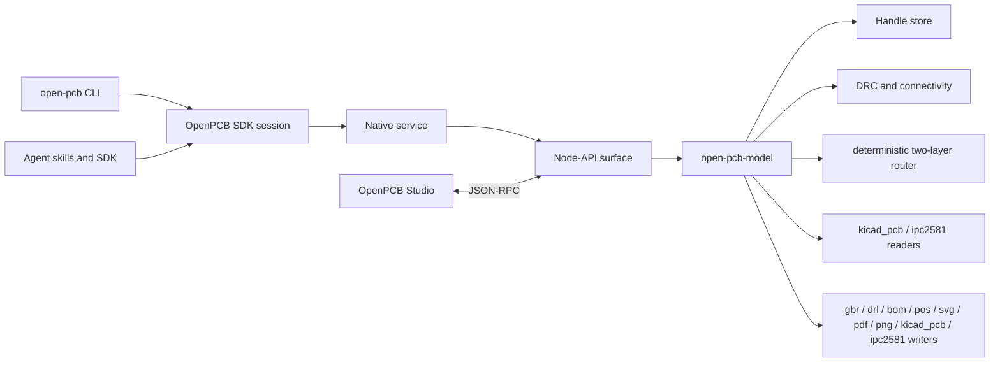

# OpenPCB

[](https://github.com/nyar-os/OpenPCB)
[](https://github.com/nyar-os/OpenPCB)
[](https://github.com/nyar-os/OpenPCB)

One editable board document behind PCB layout, inspection, fabrication and
assembly.

OpenPCB is a desktop studio and command line for embedded printed circuit
boards. A project is a single `.opcb` document: copper layers and stackup,
footprints, nets, tracks and vias, plus fabrication and assembly state stay in
one revisioned model instead of being scattered across a folder of exchange
files.

## Status

This repository ships a tested MVP of the board document. The command line,
SDK and studio shell share one native model:

- Create, open, save, inspect, export and close a revisioned `.opcb` document.
- Add nets, footprints, tracks and through, blind or buried vias; move and
  update footprints; delete footprints, tracks and vias.
- Add, rename, hide and lock layers; set a rectangular board outline.
- Undo and redo up to 32 snapshots per handle, optionally persisted in
  `<file>.history.json` with `history: 'sidecar'`, with `canUndo`/`canRedo` on
  every summary and edit result.
- Route every net with at least two pads through a deterministic two-layer
  autorouter that reports collisions instead of inventing copper.
- Declare differential pairs with a target width, gap and maximum length skew,
  then compare the routed copper against those targets.
- Run DRC, connectivity, clearance, annular ring, stackup, outline, silkscreen,
  courtyard, netlist, `annular-ring`, `track-width`, `unrouted`, `diffpair` and
  `dangling-copper` checks.
- Import a KiCad PCB or IPC-2581 document into the native document: copper
  layers, nets, footprints and pads, tracks, through, blind and buried vias and a
  rectangular profile, with a stable loss ledger for everything the document
  cannot hold. Micro vias imported from KiCad stay in that ledger instead of
  being approximated.
- Write Gerber RS-274X, Excellon drill, BOM, pick-and-place, SVG, vector PDF,
  8-bit RGB PNG, KiCad PCB and IPC-2581 files atomically. Gerber writes one
  file per copper layer plus `F_SilkS`, `B_SilkS` and `Edge_Cuts`; the two
  silkscreen files carry the legend tracks the document holds. One Excellon file
  lists every drilled hole, including blind and buried vias.

STEP export remains declared and rejects with `capability/not-implemented`. PNG
is an export writer only; preview rendering stays SVG-only. The interactive
viewport renderer is not implemented either. The capability matrix reports
through, blind and buried vias as supported, micro vias as unsupported, and
both `kicad_pcb` and `ipc2581` import as supported. `open-pcb capabilities`
prints exactly that matrix.

## Usage

```bash
# Print the implemented capability matrix
open-pcb capabilities

# Create a native board document
open-pcb create --out blinker.opcb --title "Blinker" --template blank

# Import a KiCad board or an IPC-2581 document and report every construct the
# document could not keep; the format is detected from the content
open-pcb import legacy.kicad_pcb --out legacy.opcb
open-pcb import panel.ipc2581 --out panel.opcb

# Declare a differential pair with its routing targets
open-pcb diffpair add blinker.opcb --positive USB_D+ --negative USB_D- --width 0.2 --gap 0.15 --max-skew 0.5
open-pcb diffpair delete blinker.opcb --id dp-1

# Declare a net, place a footprint, route a track and add a via
open-pcb net add blinker.opcb --name VCC
open-pcb footprint add blinker.opcb --ref U1 --value MCU --footprint QFN32 --x 30 --y 20 --rotation 0 --layer F.Cu
open-pcb track add blinker.opcb --net VCC --layer F.Cu --from 10,10 --to 30,10 --width 0.25
open-pcb via add blinker.opcb --net VCC --at 20,20 --diameter 0.6 --drill 0.3
open-pcb via add blinker.opcb --net VCC --at 25,20 --diameter 0.6 --drill 0.3 --from-layer F.Cu --to-layer In1

# Route all two-pad nets, then route only VCC at a wider width
open-pcb route blinker.opcb
open-pcb route blinker.opcb --width 0.3 --clearance 0.2 --via 0.6 --net VCC

# Move, update or delete a footprint; delete a track or via by id
open-pcb footprint move blinker.opcb --id fp-1 --x 40 --y 25 --rotation 90
open-pcb footprint update blinker.opcb --id fp-1 --value SAMD21 --footprint TQFP32
open-pcb footprint delete blinker.opcb --id fp-1
open-pcb track delete blinker.opcb --id track-1
open-pcb via delete blinker.opcb --id via-1

# Add, rename, hide and lock a layer
open-pcb layer add blinker.opcb --name Inner1 --kind copper
open-pcb layer rename blinker.opcb --id Inner1 --name Inner2
open-pcb layer visible blinker.opcb --id Inner2 --visible false
open-pcb layer lock blinker.opcb --id Inner2 --locked true

# Set a rectangular outline, then undo or redo the last saved revision
open-pcb outline set blinker.opcb --from 0,0 --to 100,80
open-pcb undo blinker.opcb
open-pcb redo blinker.opcb

# Read the board and run the implemented checks
open-pcb list blinker.opcb
open-pcb inspect blinker.opcb --checks drc,connectivity,clearance,annular-ring,track-width,unrouted,stackup,outline

# Export the implemented targets; Gerber writes one file per copper layer plus silk and edge cuts
open-pcb export blinker.opcb --format gbr --out gerber
open-pcb export blinker.opcb --format drl --out blinker.drl
open-pcb export blinker.opcb --format bom --out blinker.bom.csv
open-pcb export blinker.opcb --format pos --out blinker.pos.csv
open-pcb export blinker.opcb --format svg --out blinker.svg
open-pcb export blinker.opcb --format pdf --out blinker.pdf
open-pcb export blinker.opcb --format kicad_pcb --out blinker.kicad_pcb
open-pcb export blinker.opcb --format ipc2581 --out blinker.ipc2581
open-pcb export blinker.opcb --format png --out blinker.png

# Open the studio window
open-pcb gui
```

Editing commands open the document through the SDK, apply one validated
mutation, bump the revision and write the file back through a temporary file and
rename. A rejected edit leaves the document unchanged. Unsupported export
formats fail before any file is written. The CLI runs an `OpenPCB` session with
`history: 'sidecar'`, so it keeps up to 32 previous documents in
`<file>.history.json` and `undo`/`redo` work across invocations; the SDK default
and the studio use the per-handle history in the native store.

## SDK

The command line is a thin shell over the same session the SDK exposes:

```ts
import { OpenPCB } from '@wae/open-pcb';

const pcb = new OpenPCB(); // `history: 'memory'` is the default
const board = await pcb.create({ title: 'Blinker' });

await board.addNet({ name: 'VCC' });
await board.addDifferentialPair({ positive: 'USB_D+', negative: 'USB_D-', width: 0.2, gap: 0.15, maxSkew: 0.5 });
await board.addFootprint({ reference: 'U1', value: 'MCU', footprint: 'QFN32', x: 30, y: 20, layer: 'F.Cu' });
await board.addTrack({ net: 'VCC', layer: 'F.Cu', width: 0.25, from: [10, 10], to: [30, 10] });
await board.addVia({ net: 'VCC', at: [20, 20], diameter: 0.6, drill: 0.3 });
await board.setOutline({ from: [0, 0], to: [100, 80] });
await board.route(); // { routed, unrouted, tracks, vias }

await board.save({ target: 'blinker.opcb' });
await board.export({ format: 'gbr', target: 'gerber' });
await board.undo();
await board.redo();

// Import a KiCad PCB or IPC-2581 document and keep the wrapped document for
// further edits; `format` reports what the engine detected
const imported = await pcb.importBoard({ path: 'panel.ipc2581', target: 'panel.opcb' });
console.log(imported.format, imported.board.summary.counts.footprints, imported.losses.length);

await imported.board.close();
await board.close();
await pcb.dispose();
```

`capabilities()`, `create`, `open`, `importBoard`, `inspect` and `dispose`
belong to the session; every edit, inspection, save and export is a `Board`
method, so no command bypasses the document. `importKicadPcb` remains as the
KiCad-only spelling of `importBoard`.

`new OpenPCB({ history: 'sidecar' })` persists undo history in
`<file>.history.json` beside the document, so `undo` and `redo` cross process
boundaries. Each mutation snapshots the old file, writes the new one atomically
and clears the redo branch; `undo`/`redo` swap snapshots, bump the restored
revision and reopen the document. Saving to a new target updates the document's
target path and drops any stale sidecar already beside it. The sidecar module
loads `node:fs` through a dynamic import, so a memory session never pulls it in.

## Architecture



The TypeScript layer owns argument parsing, help text and exit codes. The native
bridge maps values only; board semantics stay in `open-pcb-model`, and the
studio talks to the same operations over JSON-RPC. The native `.opcb` document
is UTF-8 JSON: `{ "format": "open-pcb-board", "version": 1, "document": { ... } }`.

## What it does NOT do

- It does not import STEP files. KiCad PCB import maps copper layers, nets,
  footprints and pads, tracks, through, blind and buried vias and a rectangular
  `Edge.Cuts` outline; zones, dimensions, text, arcs, polygons, micro vias,
  footprint graphics and non-rectangular outlines are reported in the import
  loss ledger instead of being approximated. IPC-2581 import reads a rectangular
  profile, packages and pins, components, logical nets, line features and plated
  holes; footprints on non-copper layers, non-rectangular profiles, non-plated
  holes and undeclared nets are reported in its own loss ledger.
- It does not export STEP. PNG export is a fixed 1024x768 top-down raster; it
  does not render silkscreen text, zones or a live viewport.
- The router is a deterministic orthogonal MST router: it tries four
  L-shaped candidates per edge and reports an edge as unrouted rather than
  approximating a path. It does not rip up, use diagonal tracks or route
  multi-layer inner copper.
- Pad annulus is not checked because the document model stores no pad drill;
  `annular-ring` evaluates vias only.
- It does not render an interactive board viewport; SVG export is a writer, not
  a viewport.
- It does not store silkscreen text or shapes. The `silkscreen` check therefore
  reports `silkscreen/no-reference-text` as a warning while still checking pad
  placement against the outline.
- Silkscreen legend geometry is stored as tracks on silkscreen layers: the SVG
  and PDF writers draw them, the Gerber writer emits them into `F_SilkS` and
  `B_SilkS`, and the `silkscreen-over-pad` check reads them. DRC treats a
  silkscreen track as legend rather than a copper rule violation.
- It does not rotate rectangular pad apertures in Gerber output.
- It does not edit zones, use templates other than `blank`, persist undo
  history inside `.opcb`, or resolve concurrent edits against an older revision.
- It does not claim a format is supported because an extension is known.

Classification is not a support claim. A format may be listed in the registry
while remaining `unsupported` in the capability matrix.

## Repository layout

```text
projects/
├── packages/
│   ├── open-pcb            # CLI, SDK and native bridge
│   ├── open-pcb-ui         # OpenPCB Studio window
│   ├── open-pcb-skills     # agent skills package
│   ├── open-pcb-win32-x64  # native addon, Windows x64
│   ├── open-pcb-darwin-x64 # native addon, macOS x64
│   ├── open-pcb-darwin-arm64
│   ├── open-pcb-linux-x64
│   └── open-pcb-linux-arm64
└── sites/
    └── homepage            # product site
```

## License

Mozilla Public License 2.0. See [License.md](License.md).
